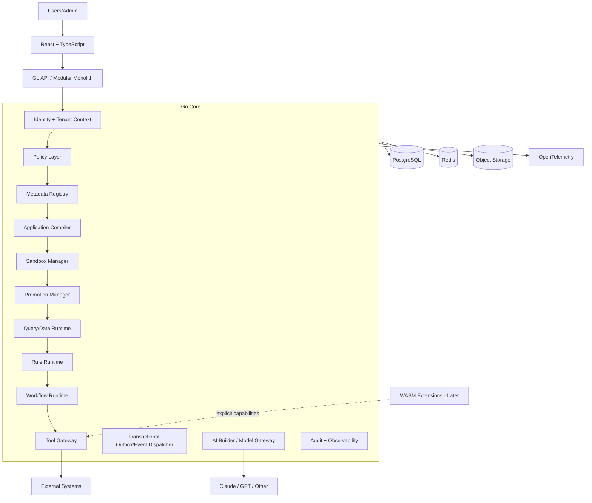

# Target Architecture

## Why modular monolith first
- easier transactions
- fewer deployment failure modes
- easier end-to-end tracing
- simpler for a small team and coding agents
- preserves clean extraction boundaries for future scale

## Future extraction candidates
AI gateway, workflow workers, integration workers, analytics/reporting, WASM host.
