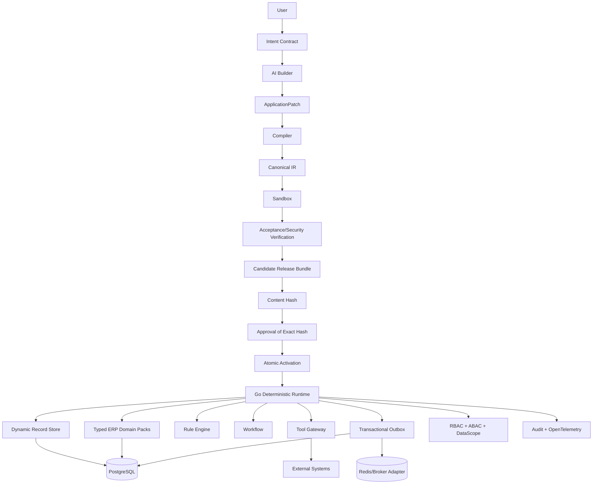

# V3 Architecture Freeze

## Languages
- React/TypeScript: UI
- Go: core compiler/runtime/platform
- PostgreSQL/SQL: durable state
- JSON/YAML: authoring format
- Rust/WASM: later, only for isolated extensions/hotspots
- Python: later, specialized ML/analytics only

## Style
Keep modular monolith for now.
